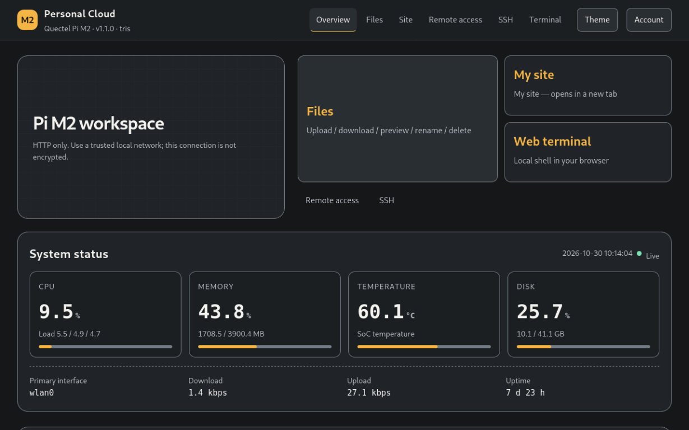

[简体中文](README_ZH.md)

# Personal Cloud Host for Quectel Pi M2

Turn a [Quectel Pi M2](https://developer.quectel.com/doc/sbc/en/index.html) into a personal cloud host for your local network. The project provides a web dashboard, file access, static-site hosting, a browser-based terminal, and SSH access through a one-command installer.



> **Scope:** The portal serves HTTP within the local network by default. Do not expose the portal, File Browser, terminal, or backend service ports directly to the public Internet; for public-network access, use the built-in Peanut (PHTunnel) NAT traversal channel (`--with-peanut`). HTTPS is not part of this release.

## Features

- System dashboard for CPU, memory, temperature, storage, network traffic, and uptime.
- Authenticated file browser with upload, download, and common file operations.
- Static website hosting from `~/cloud/www`.
- Optional browser-based local shell.
- SSH access using the board's SSH service; the portal can show a ready-to-copy command.
- One-command installation and uninstall, with user files under `~/cloud` retained on uninstall.
- English and Simplified Chinese portal interface.

## Requirements

- Quectel Pi M2 (RK3576) running Debian 13, with network access.
- A user account with `sudo` privileges.
- A phone or computer on the same local network.

Configure and test SSH public-key access before installation if you plan to use SSH. The installer only disables SSH password authentication when it finds an authorized key for the service user.

## Install

```bash
git clone https://github.com/Quectel-Pi/demo-personal-cloudhost.git
cd demo-personal-cloudhost
sudo ./install.sh
```

The installer prompts for the initial portal password and installs the required services. To see all supported options, run:

```bash
./install.sh --help
```

After installation, open `http://<board-ip>/` from a device on the same local network. Find the board's address with:

```bash
hostname -I
```

For typical sign-in, use the board's service-user account and system password when PAM authentication is available. If installation falls back to password-hash authentication, use the `admin` account and the password entered during installation.

## Related Projects

More board demos are available in the [Quectel-Pi](https://github.com/Quectel-Pi) organization:

- [demo-smart-nas-system](https://github.com/Quectel-Pi/demo-smart-nas-system): a smart NAS system for Quectel Pi.
- [demo-gesture-remote-control](https://github.com/Quectel-Pi/demo-gesture-remote-control): touchless video control based on hand gesture recognition.
- [demo-ipc-console](https://github.com/Quectel-Pi/demo-ipc-console): an IPC camera console application with camera discovery.
- [demo-rknn-object-detect](https://github.com/Quectel-Pi/demo-rknn-object-detect): real-time object detection and multi-object tracking.

## Documentation

- [User guide](docs/user-guide.md): installation, sign-in, files, SSH, maintenance, and troubleshooting.
- [简体中文用户指南](docs/user-guide_zh.md)
- [简体中文项目介绍](README_ZH.md)

## Security and limitations

- The default portal uses plain HTTP on the local network; credentials and traffic are not encrypted in transit.
- Do not forward the portal, File Browser, terminal, or backend service ports to the Internet.
- The browser terminal runs a local shell as the configured service user; disable it with `--no-ttyd` if it is not needed.
- SSH is a separate system service. Use key-based authentication and verify the host key when connecting.
- This project is a board demo, not a hardened, multi-tenant cloud-hosting service.

## Reporting Issues
If you encounter any issues during use, please submit technical inquiries on the [Quectel Official Forum](https://forumschinese.quectel.com/c/quectel-pi/58). Our technical support team will respond promptly.
Issues and Pull Requests are welcome to help improve this project.
