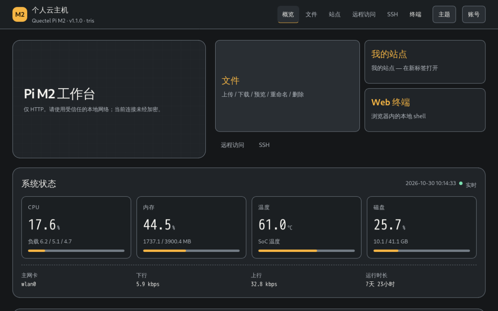

[English](README.md)

# Quectel Pi M2 个人云主机

将 [Quectel Pi M2](https://www.quectel.com.cn/docs/quectel-pi/m2) 变成一台供局域网使用的个人云主机，提供 Web 状态门户、文件访问、静态站点托管、浏览器终端和 SSH，并通过一键脚本完成部署。



> **适用范围：**门户默认通过局域网 HTTP 提供服务。请勿将门户、文件服务、终端或后端服务端口自行转发到公网；如需外网访问，请使用内置的花生壳（PHTunnel）内网穿透通道（`--with-peanut`）。HTTPS 不属于本版本范围。

## 功能

- 查看 CPU、内存、温度、磁盘、网络流量和运行时间。
- 经过鉴权的文件浏览、上传、下载及常见文件操作。
- 从 `~/cloud/www` 发布静态网站。
- 可选的浏览器本地终端。
- 通过开发板 SSH 服务登录，门户可生成可复制的连接命令。
- 一键安装与卸载；卸载时保留 `~/cloud` 下的用户文件。
- 门户支持英文和简体中文。

## 环境要求

- 搭载 Debian 13 的 Quectel Pi M2（RK3576），并可访问网络。
- 具有 `sudo` 权限的用户账号。
- 与开发板处于同一局域网的手机或电脑。

如果需要使用 SSH，建议先配置并验证 SSH 公钥。只有检测到服务用户存在已授权公钥时，安装脚本才会关闭 SSH 密码登录。

## 安装

```bash
git clone https://github.com/Quectel-Pi/demo-personal-cloudhost.git
cd demo-personal-cloudhost
sudo ./install.sh
```

安装程序会提示设置门户初始密码并部署所需服务。查看全部参数：

```bash
./install.sh --help
```

安装完成后，在同一局域网的设备上打开 `http://<开发板IP>/`。可通过以下命令查看开发板 IP：

```bash
hostname -I
```

PAM 系统账号认证可用时，通常使用开发板的服务运行账号和系统密码登录。若安装时回退到密码哈希认证，则使用 `admin` 账号及安装时设置的密码。

## 相关项目

更多开发板 Demo 请见 [Quectel-Pi](https://github.com/Quectel-Pi) 组织主页：

- [demo-smart-nas-system](https://github.com/Quectel-Pi/demo-smart-nas-system)：适用于 Quectel Pi 的智能 NAS 系统。
- [demo-gesture-remote-control](https://github.com/Quectel-Pi/demo-gesture-remote-control)：基于手势识别的非接触式控制 Demo。
- [demo-ipc-console](https://github.com/Quectel-Pi/demo-ipc-console)：IPC 摄像头控制台应用，支持摄像头发现。
- [demo-rknn-object-detect](https://github.com/Quectel-Pi/demo-rknn-object-detect)：实时目标检测与多目标跟踪。

## 文档

- [中文用户指南](docs/user-guide_zh.md)：部署、登录、文件、SSH、维护和故障排查。
- [English user guide](docs/user-guide.md)
- [English project overview](README.md)

## 安全与限制

- 默认门户通过局域网 HTTP 提供服务，传输中的凭据和数据未加密。
- 不要将门户、文件服务、终端或后端服务端口转发到公网。
- 浏览器终端会以配置的服务用户身份启动本地 shell；不需要时可通过 `--no-ttyd` 禁用。
- SSH 是独立的系统服务。请使用密钥认证，并在连接时核验主机密钥。
- 本项目是开发板 Demo，不是经过加固的多租户云托管服务。

## 报告问题
如在使用过程中遇到问题，欢迎在[移远官方论坛](https://forumschinese.quectel.com/c/quectel-pi/58) 提交技术咨询，我们的技术支持团队将及时为您解答。
欢迎提交Issue和Pull Request来改进此项目。
